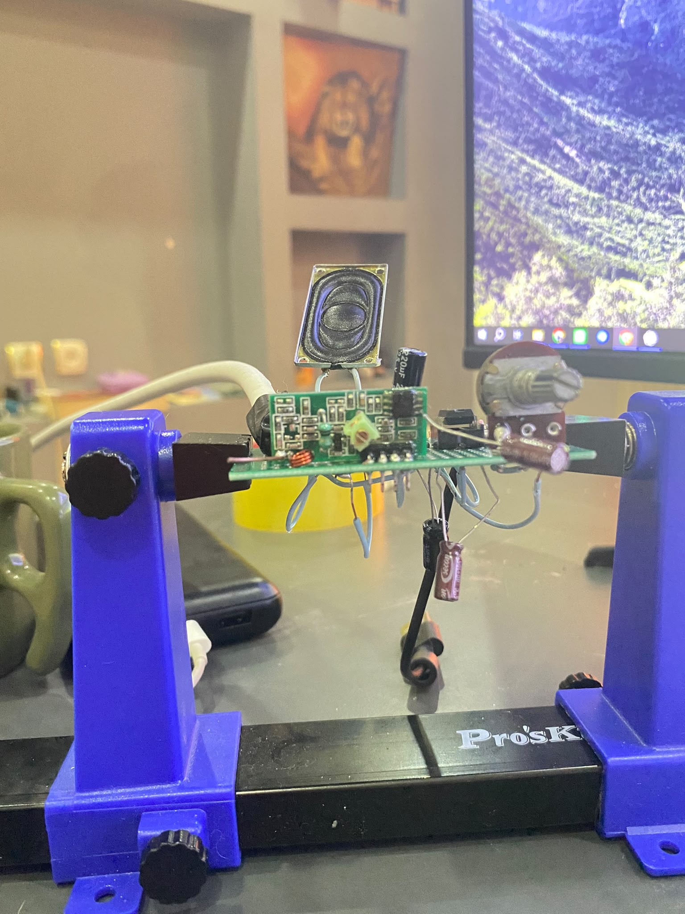
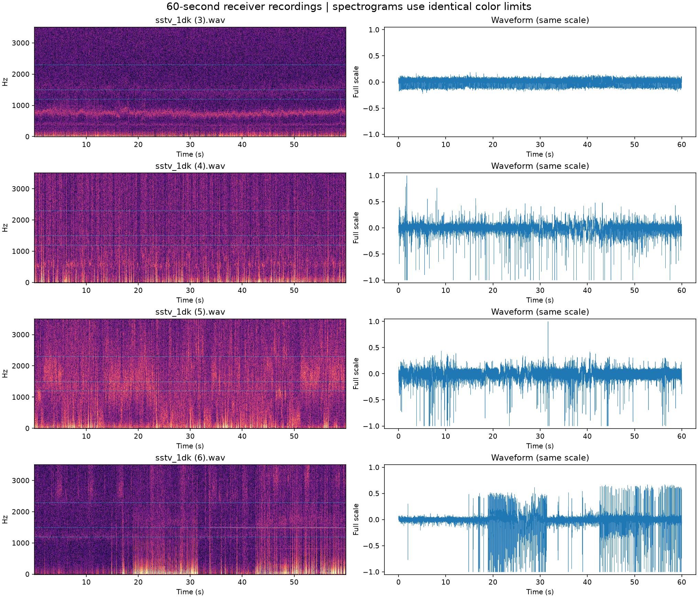
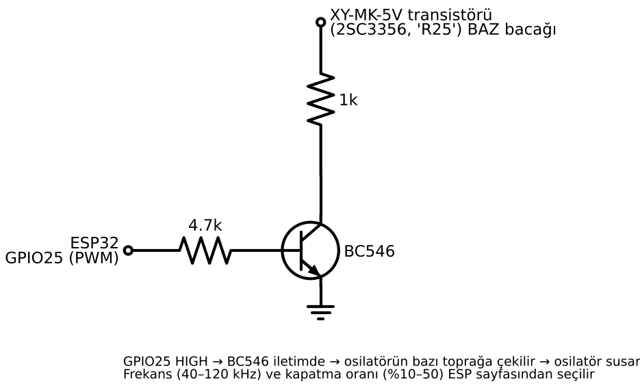
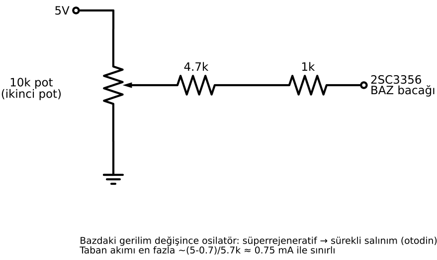

# ISS SSTV Lab — 433 MHz Alıcıyla RF Deneyleri

**Türkçe** | [English](README.en.md)

Ucuz bir **XY-MK-5V / MX-RM-5V** kumanda alıcısıyla ISS'in SSTV görüntülerini alabilir miyim? Bu proje, bu sorudan yola çıkan bir elektronik deney günlüğü: alıcıyı yeniden ayarlama, AM/FM denemeleri, ESP32 ile ses kaydı ve Python ile sinyal analizi.

**Durum:** AM melodi alımı gösterildi; FM alımıyla uyumlu zayıf ses ve ton bulguları elde edildi. **SSTV görüntüsü çözülemedi.** Buradaki WAV dosyaları Raspberry Pi ile yapılan yerel testlerden geliyor; ISS'ten alınmış görüntü veya doğrulanmış bir ISS kaydı içermiyor.



**[AM videosunu indir — MP4, yaklaşık 11 saniye](https://github.com/altunsumerve/iss-sstv-superregen/raw/refs/heads/main/medya/am_melodi_demo.mp4)** · [Devre fotoğrafları](medya/README.md) · [Kayıt incelemesi](belgeler/kayit_incelemesi.md) · [WAV dosyaları](kayitlar/README.md)

Video bağlantısı doğrudan MP4 dosyasına gider. Tarayıcın dosyayı indirirse indirilen videoyu medya oynatıcında aç. GitHub dosya sayfası bu video için oynatıcı göstermeyebilir.

## Amaç ve deney düzeni

Hedef, [ARISS](https://www.ariss.org/) SSTV yayınlarına yönelik düşük maliyetli bir alıcı denemekti. Elimde telsiz veya RTL-SDR olmadığı için, AM/OOK için tasarlanmış süperrejeneratif bir 433 MHz modülü kullandım.

| Parça | Görevi |
|---|---|
| XY-MK-5V / MX-RM-5V | Ayarlı bobiniyle frekansı değiştirilen RF alıcısı |
| LM386, 10 kΩ pot ve hoparlör | Alınan sesi dinleme |
| BC546, 4,7 kΩ ve 1 kΩ direnç | ESP32 ile dış söndürme denemesi |
| İkinci 10 kΩ pot ve seri 4,7 kΩ + 1 kΩ | Otodin denemesinde alıcı transistörünün baz gerilimini ayarlama |
| Koaksla beslenen dipol, 2 × 16 cm | 437 MHz civarı için deney anteni |
| ESP32 | ADC ile örnekleme, Wi-Fi üzerinden WAV kaydı; dış söndürme denemesinde PWM |
| Raspberry Pi 3 + [rpitx](https://github.com/F5OEO/rpitx) | AM, FM ton ve Robot36 test sinyalleri |
| Python | Spektrum, ton/gürültü karşılaştırması ve SSTV çözme denemeleri |

SSTV testi için Pi'deki `test.png`, `pysstv` ile **Robot36, 48 kHz** ses dosyasına (`sstv48.wav`) çevrildi. Yaklaşık 36 saniyelik görüntü sesi, `testnfm.sh` ile **437,5 MHz** üzerinde FM olarak gönderildi. Deneyi tekrarlamak için kendi seçtiğiniz bir görseli aynı şekilde SSTV sesine dönüştürebilir veya Robot36 modunda, 48 kHz örnekleme hızında hazır bir SSTV test sinyali kullanabilirsiniz. Test, Robot36/FM zincirini deniyor; ISS bağlantısının gücünü, Doppler kaymasını veya RF koşullarını birebir taklit etmiyor.

Bağlantılar ve devre şemaları: [Bağlantı rehberi](belgeler/baglantilar.md#turkce).

## Sonuçlar

| Deney | Gözlem | Sonuç |
|---|---|---|
| Frekans ayarı ve AM | Bobin ayarı sonrası 430–439 MHz taramasında melodi duyuldu; en güçlü 434 MHz civarı | AM alımı gösterildi |
| FM eğim dedeksiyonu | Merkezde duyulmayan FM melodi, frekans yanlara kaydırılınca kısık duyuldu | Eğim dedeksiyonuyla uyumlu |
| Robot36 SSTV | Ham ve işlenmiş kayıtlardan görüntü elde edilemedi | Başarılı çözüm yok |
| Söndürme frekansından FM | İlk umut verici bulgu, Pi sızıntısı azaltılınca tekrarlanmadı | Güvenilir kanıt yok |
| ESP32 ile dış söndürme | Ses yükseldi, fakat kullanılan ton/gürültü ölçütü iyileşmedi | Denenen ayarlarda iyileşme yok |
| Otodin / sürekli osilasyon | Duyulan ıslığın gelen sinyali izlediği doğrulanamadı | Sonuçsuz; kart bu deneyde bozuldu |

### AM ve FM bulguları

[AM videosu](https://github.com/altunsumerve/iss-sstv-superregen/raw/refs/heads/main/medya/am_melodi_demo.mp4), hoparlörlü düzeneği ve Pi'deki frekans taramasını gösteriyor. Mikrofon kaydının [spektrumunda](grafikler/9_am_video_spektrumu.png) değişen melodi tonları ve harmonikleri seçiliyor. Bu video AM denemesinin gösterimidir; FM/SSTV başarısı olarak sunulmuyor.

| Frekans | AM melodi | FM melodi |
|---|---|---|
| 434 MHz | En güçlü | Duyulmadı |
| 436 / 437,5 / 439 MHz | Duyuldu | Kısık duyuldu |

Bir FM ton kaydında 2304 Hz çevresindeki çizgi için mevcut analiz betiğinin çıktısı:

```text
2304 Hz  verici kapali:  +2.0 dB   verici acik:  +5.8 dB
```

Bu değer, dar bir frekans bölgesinin çevresindeki spektral arka plana oranıdır; toplam ses SNR'si veya alıcının dBm cinsinden hassasiyeti değildir. Doğrudan RF sızıntısı, kontrol kayıtlarıyla ayrıca değerlendirilmelidir.

### SSTV kayıtlarının yeniden incelenmesi

Dört adet 60 saniyelik kayıt; ham, 900–2600 Hz bant filtreli ve spektral çıkarma uygulanmış biçimleriyle otomatik çözücüden geçirildi. **12 denemenin hiçbirinde görüntü bulunmadı.** Aynı çözücü, ayrıca üretilen temiz Robot36 kontrol sesini kayıtlarla aynı hız olan 9999 örnek/saniyede başarıyla çözdü. Kontrol görüntüsü, RF alım sonucu değildir.

| Özgün dosya | Tam ölçek sınırındaki örnekler | Gözlem |
|---|---:|---|
| `sstv_1dk (3).wav` | %0 | Daha sakin; otomatik çözüm yok |
| `sstv_1dk (4).wav` | %0,1073 | Yaygın ani darbeler; otomatik çözüm yok |
| `sstv_1dk (5).wav` | %0,1007 | Değişken gürültü ve darbeler; otomatik çözüm yok |
| `sstv_1dk (6).wav` | %0,3615 | Özellikle yaklaşık 18–32 s ve son bölümde güçlü darbeler; otomatik çözüm yok |



Grafikteki yatay kılavuzlar 1200, 1500 ve 2300 Hz'i gösterir; sinyal tespiti değildir. Görüntü çıkmaması, kayıtta hiç SSTV bilgisi bulunmadığını kanıtlamaz. Tam ve tutarlı bir SSTV yapısı doğrulanamadı.

**Kırpılma notu:** Firmware uzun kayıt yolunda sesi varsayılan olarak `sesKazanc = 4` ile büyütüp 16 bit sınırlara kırpıyor. Dosyadaki kırpılma tek başına RF katının veya ADC'nin doyduğunu göstermez. WAV başlığı da kayıt sırasında hiç örnek kaybolmadığını kanıtlamaz; bunun için cihazın taşma sayaçları gerekir.

### Söndürme ve otodin denemeleri

Söndürme (*quench*), süperrejeneratif devrede osilasyonun tekrar tekrar başlayıp durmasıdır. [Neal Brown'ın patenti](https://patents.google.com/patent/US3337807A/en), bu sinyalden modülasyonu geri kazanma fikrinin kaynaklarından biridir; bu kartta başarı garantisi değildir.

200 kHz sınıfındaki kısa kayıtlarda 42 kHz civarındaki bileşen incelendi. İlk deneyde 52–60 kHz bölgesindeki Pi sızıntısı yanıltıcı bir iz oluşturdu. Son incelenen yedi kısa kayıt yaklaşık **0,145 saniye** uzunluğunda; 2304 Hz test tonunun söndürme frekansı değişiminde güvenilir biçimde geri kazanıldığı gösterilemedi. [Kısa kayıt karşılaştırması](grafikler/8_kisa_kayit_karsilastirma.png).

Dış söndürmede ESP32 GPIO25, BC546 ve dirençlerle alıcının transistör bazı periyodik olarak aşağı çekildi. 40–100 kHz ve %10–30 kapatma oranları denendi. Seçilen 100 kHz / %30 ayarında ton varken ölçüt **+5,8 dB** kaldı; dış söndürme kapalıyken de aynıydı. Bu sonuç yalnızca denenen devre ve ayarlar için geçerlidir.



**İkinci pot:** Ses potundan ayrı olan **10 kΩ pot**, otodin denemesinde kullanıldı. İki dış ucu 5 V ve GND'ye; orta ucu **4,7 kΩ + 1 kΩ seri direnç** üzerinden alıcı transistörünün bazına bağlandı. Bu aşamada 1 kΩ direncin BC546 kolektörüne giden ucu ayrıldı. Bu, PWM ile dış söndürmenin yerine denenen farklı bir bağlantıdır; iki devre aynı anda baza bağlı gösterilmemelidir. [Ayrıntılı bağlantılar ve deney sınırları](belgeler/baglantilar.md#ikinci-pot).



Şemalar deneyde kullanılan bağlantıları belgeler. Otodin şemasındaki sürekli osilasyona geçiş ifadesi deneyin hedefidir; doğrulanmış bir sonuç değildir. Şemadaki yaklaşık 0,75 mA hesabı da yalnızca ek direnç kolunun, varsayılan 0,7 V baz gerilimiyle hesabıdır; transistörün toplam akımı veya güvenli çalışma garantisi değildir.

Otodin denemesinde sürekli osilasyona geçilerek bir vuru frekansı aranıyordu. Pi frekansı 1 kHz değiştirildiğinde izleyen bir çizgi bulunamadı. 3994 Hz çizgisi Pi kapalıyken de vardı. Kart, daha yüksek hızlı kayda geçilemeden bozuldu.

## Bu deney neyi gösteriyor, neyi göstermiyor?

- Yerel AM alımı ve FM alımıyla uyumlu bulgular var; başarılı ISS SSTV alımı yok.
- Geniş alıcı bant genişliği ve zayıf FM dönüşümü olası sınırlamalar. Kayıt zincirindeki gürültü, sızıntı ve kırpılma da etkili olabilir.
- Önceki yaklaşık **20–25 dB** gürültü altı hesabı, dar bir FFT bölgesinden daha geniş banda yapılan bir tahmindi. Kalibre edilmiş hassasiyet ölçümü veya kesin SSTV başarı sınırı olarak kullanılmamalıdır.
- Pi'nin alıcıya yakın olması tek başına iyi tanımlanmış bir test seviyesi sağlamaz; sızıntı ve aşırı sürme olasılığı vardır.
- Kayıtlar, devrede farklı zamanlarda yapılan değişikliklerin ardından alınmıştır. Bu değişiklikler proje dosyalarında açıklanmıştır.
- Yardımcı RF osilatörü gibi sonraki fikirler bu projede doğrulanmış sonuçlar arasında değildir.

## Kurulum ve analiz

### ESP32

Arduino IDE ve Arduino-ESP32 core 3.x kullanıldı. [Firmware](firmware/esp_kayit/esp_kayit.ino) içindeki `WIFI_ADI` ve `WIFI_SIFRE` yer tutucularını yerel olarak doldurup karta yükle. Seri monitörde 115200 baud ile görünen adresi tarayıcıda aç. Gerçek Wi-Fi bilgilerini paylaşılacak dosyaya veya commit'e ekleme.

### Python

Python 3.12 ile yapılan son incelemeyi tekrar etmek için:

```sh
python -m pip install -r requirements.txt
python analiz/ton_olc.py kayitlar/fm_ton_dis_sondurme_kapali.wav --gecis 20
python analiz/sondurme_fm.py kayitlar/h1_pi_kapali_200k_06.wav kayitlar/h3_fm_ton_200k_06.wav
python araclar/fm_temizle.py kayitlar/sstv_fm_deneme.wav
python analiz/kayit_incele.py
```

Son komut, `kayitlar/index.json` içindeki dosyaları kontrol eder; ölçümleri, çözme sonuçlarını ve sentetik pozitif kontrolü `analiz/ciktilar/` altına yazar. Bu çıktılar Git tarafından dışlanır. [İnceleme yöntemi ve sınırlar](belgeler/kayit_incelemesi.md).

Devre şemalarını yeniden üretmek için repo kökünde `python -m pip install -r requirements-diagrams.txt`, ardından `python analiz/semalar.py` çalıştırılır. `python analiz/grafikler.py`, ilk altı deney grafiğini yeniden yazar; bu eski grafiklerin yorum sınırları [grafik dizininde](grafikler/README.md) açıklanır.

## Dosyalar

| Yol | İçerik |
|---|---|
| [firmware/esp_kayit/](firmware/esp_kayit/) | ESP32 kayıt sunucusu |
| [analiz/](analiz/) | Ton, söndürme ve kayıt inceleme betikleri |
| [araclar/fm_temizle.py](araclar/fm_temizle.py) | Filtreleme ve SSTV çözme denemesi |
| [kayitlar/](kayitlar/README.md) | Ham WAV dosyaları, özgün ad eşlemesi ve SHA-256 özeti |
| [medya/](medya/README.md) | Devre fotoğrafları ve AM gösterim videosu |
| [grafikler/](grafikler/README.md) | Deney grafikleri ve son karşılaştırmalar |
| [belgeler/](belgeler/) | Bağlantılar, inceleme yöntemi ve sayısal sonuçlar |

## RF deneyi notu

Testte kullanılan kısa jumper da RF yayar. rpitx çıkışının harmonikleri ve istenmeyen kuplajlar dikkate alınmalı; RF testleri uygun filtreleme, zayıflatma ve bulunduğun yerdeki kurallara göre yapılmalıdır. ISS'ten sinyal alma hedefi için gönderim yapmak gerekmez.

## Lisans

[MIT](LICENSE)
