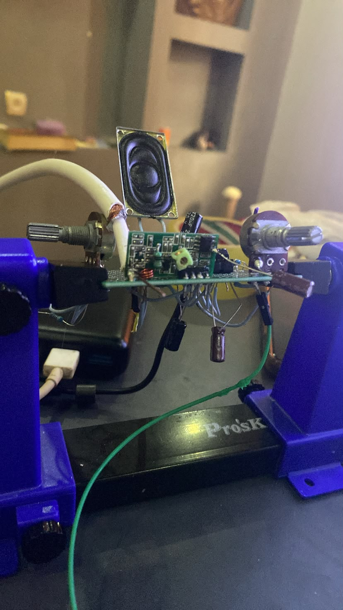
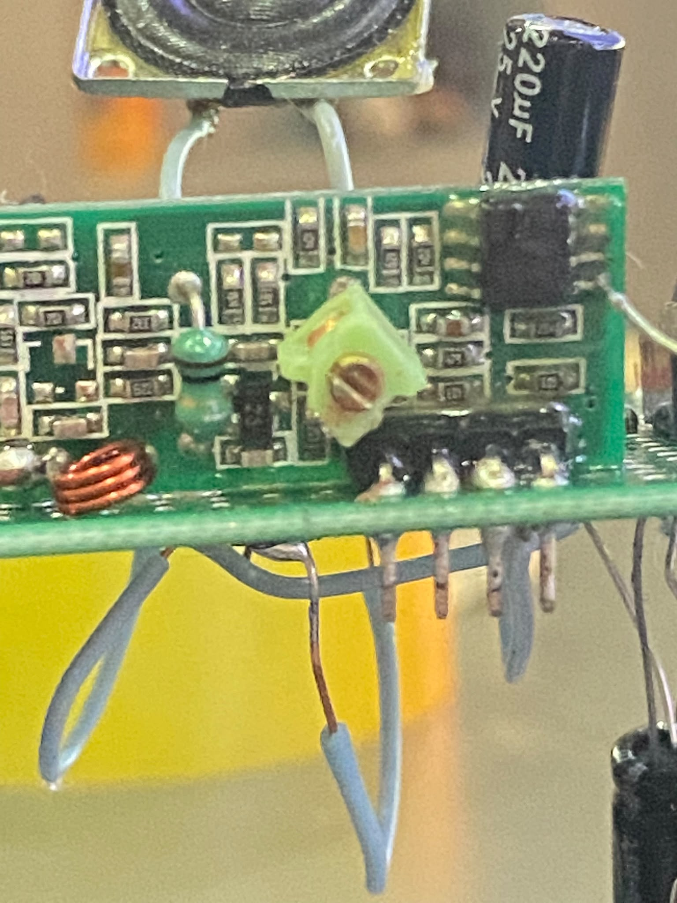
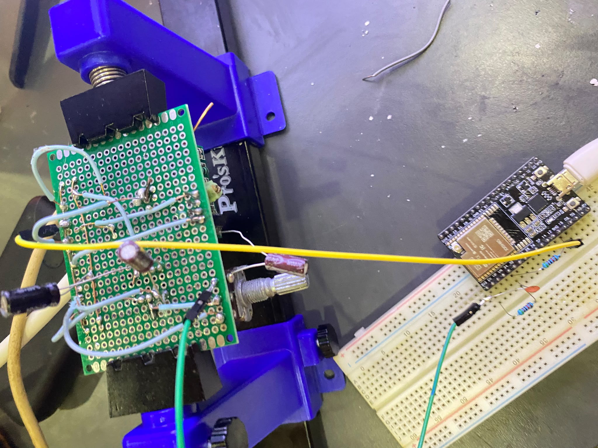
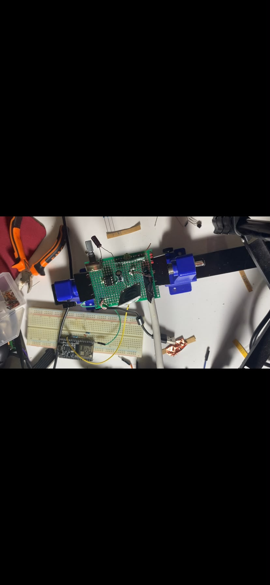

# Devre fotoğrafları ve AM videosu / Hardware photos and AM video

[Türkçe ana sayfa](../README.md) · [English overview](../README.en.md)

Fotoğraflar aynı projenin farklı aşamalarını gösteriyor. Bağlantıların güncel tarifi için [rehberi](../belgeler/baglantilar.md) kullanın.

The photos document different stages of the same project. Use the [wiring guide](../belgeler/baglantilar.md) for connection details.

## Genel görünüm / Overview

## Önden görünüm / Front view

## Alıcı yakın plan / Receiver close-up

## ESP32 bağlantısı / ESP32 connection

## Üstten ek görünüm / Additional top view

## AM gösterimi / AM demonstration

**[Videoyu indir / Download video (MP4, 10.81 s)](https://github.com/altunsumerve/iss-sstv-superregen/raw/refs/heads/main/medya/am_melodi_demo.mp4)**

Bağlantı doğrudan MP4 dosyasına gider; tarayıcı indirirse dosyayı medya oynatıcında aç. / This links directly to the raw MP4; if downloaded, open it in a media player.

Videoda düzenek, Raspberry Pi ve frekans taraması görülüyor; ses, telefonun mikrofonundan alınmıştır. Bu, AM melodi denemesinin kaydıdır. FM/SSTV çözümü veya kalibre edilmiş alıcı hassasiyeti ölçümü değildir. Monitörde yerel terminal kullanıcı/cihaz adı görünür.

The video shows the setup, Raspberry Pi and frequency sweep; its audio was captured by the phone microphone. It documents the AM melody test, not an FM/SSTV decode or calibrated sensitivity measurement. The monitor shows a local terminal user/host name.

[Ses spektrumu / Audio spectrum](../grafikler/9_am_video_spektrumu.png)
